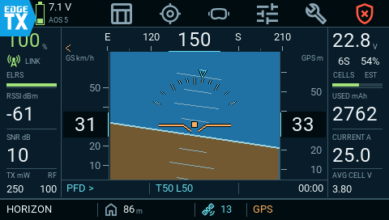

A flight dashboard and telemetry toolkit for your radio. See attitude, aircraft power, GPS and flight-controller status in one place—as a Tool or a full-screen App mode widget.

**[Download](https://github.com/yislennierm/aerodeck/releases) · [User manual](docs/USER-MANUAL.md) · [Report a problem](https://github.com/yislennierm/aerodeck/issues) · [Develop](CONTRIBUTING.md)**

Native TX16S simulator capture · sample telemetry

## Your aircraft at a glance

| Flight | Navigation | Aircraft tools |
|---|---|---|
| Attitude and heading | GPS track and local home | Arming explanations |
| Link quality and signal | Distance, bearing and motion | VTX controls and favourites |
| Voltage, current and capacity | Coordinates and position details | Sensors, diagnostics and stick guides |

Choose a full dashboard for flying or a compact widget for an ordinary home-screen zone. Preferences are saved per model. Missing telemetry stays visibly unavailable.

## Get started

1. **Install:** back up the SD card, then download an **installation ZIP** from [Releases](https://github.com/yislennierm/aerodeck/releases). Merge its `SCRIPTS`, `WIDGETS` and `LICENSES` folders into the card root, preserving existing settings.
2. **Open:** safely eject, disconnect USB and restart. Select **SYS → Tools → AERODECK**, or add the **AERODECK** widget to an **App mode** screen layout.
3. **Connect:** discover your aircraft’s sensors in EdgeTX, then check source mappings and the battery profile in AERODECK Setup.

The [user manual](docs/USER-MANUAL.md) covers widget focus, screen controls, configuration, updating and troubleshooting. Remove propellers for initial aircraft setup. GitHub’s source ZIP is not an installation package.

## Compatibility and release status

Development focuses on the **RadioMaster TX16S MkII, 480 × 272**, with EdgeTX and Betaflight/ExpressLRS. Wider display and protocol paths need their own validation; see [current support and limitations](docs/PROJECT-STATUS.md).

Check [Releases](https://github.com/yislennierm/aerodeck/releases) for available builds and prerelease status. VTX support depends on the connected equipment. Stick guides explain manual commands; they do not transmit them.

## Work on AERODECK

[Development guide](CONTRIBUTING.md) · [Repository map](docs/development/REPOSITORY.md) · [Continue a coding chat](docs/development/CONTINUITY.md) · [Third-party notices](THIRD-PARTY-NOTICES.md)

